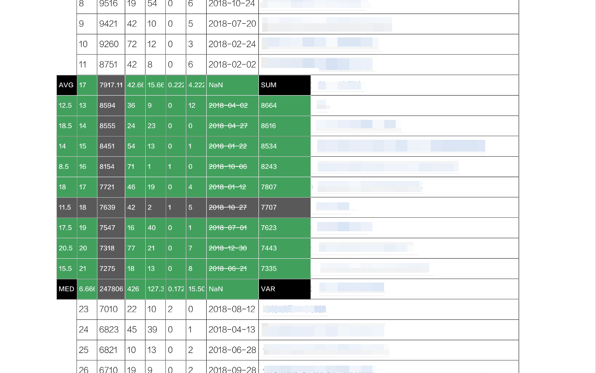
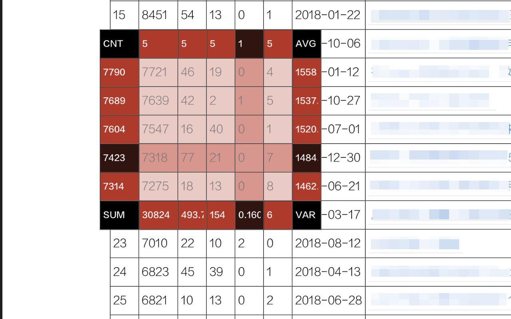
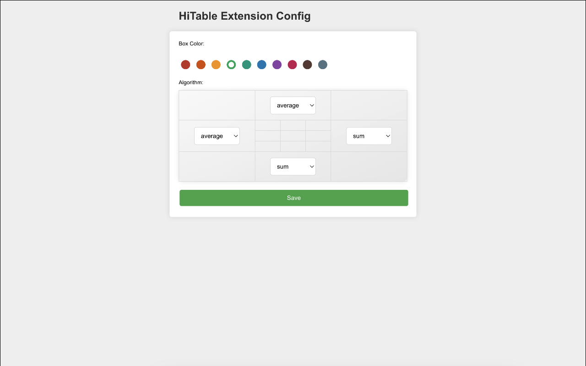
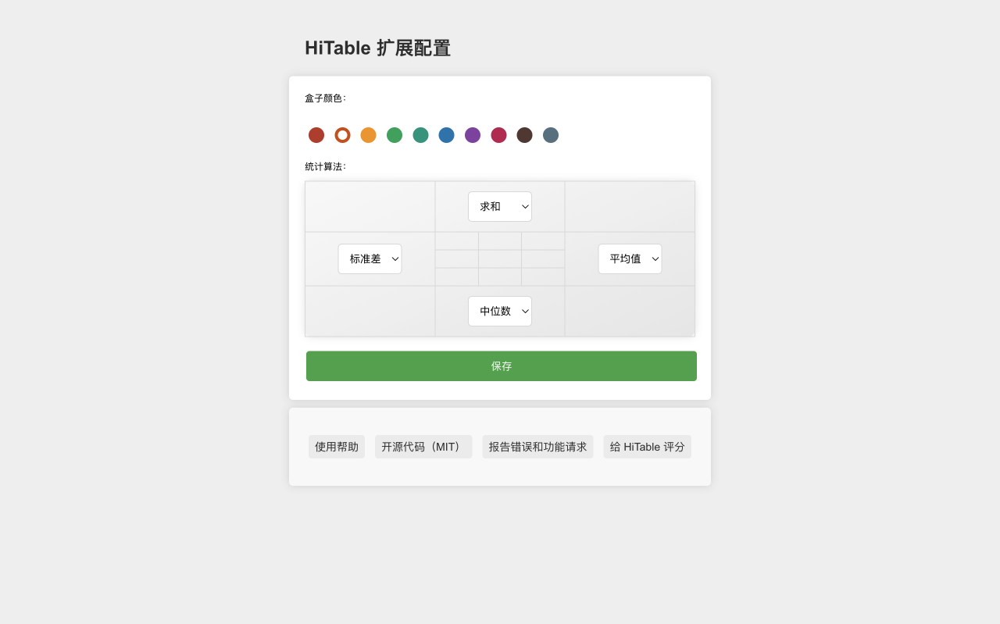

# HiTable — Instant Analysis of Web Page Table Data


%20%7C%20DE%20%7C%20RU%20%7C%20JA%20%7C%20KO%20%7C%20HI-blue?style=for-the-badge&color=8bc34a)


---

## English

> Analyze data instantly on web page tables, without leaving the page, without copying data, without Excel.

### Features

#### Table Support

- **Standard HTML tables** — including complex ones with merged cells (rowspan/colspan)
- **Nested tables** — tables inside tables, recursively flattened into one unified grid
- **Div-based tables** — CSS Grid / Flexbox layouts detected by class patterns and geometric analysis
- **ARIA grids** — elements with `role="grid"` or `role="table"` detected via semantic markers

#### 15 Statistics Algorithms

| Category | Algorithms |
|---|---|
| Basic | CNT (Count), SUM (Sum), AVG (Average), MIN (Minimum), MAX (Maximum), RNG (Range) |
| Advanced | MED (Median), STD (Standard Deviation), VAR (Variance), MOD (Mode) |
| Quantile | Q1 (25%), Q3 (75%), IQR (Interquartile Range) |
| Distribution | SKW (Skewness), KUR (Kurtosis) |

#### Conditional Formatting & Anomaly Detection

- Three-scope anomaly detection: across the entire selection, within each column, and within each row
- Values deviating from the mean by more than 2× standard deviation are highlighted with a slow pulsing animation
- Hover over anomalous cells to see the reason (global / column / row) and specific deviation values
- Toggle on/off in the configuration page

#### Data Integrity Checks

Six statistical tests to help identify potentially fabricated data:

| Test | What it checks |
|---|---|
| **Benford's Law** | First-digit distribution vs natural patterns |
| **Last Digit** | Uneven last-digit distribution (human bias) |
| **Rounding Preference** | Excessive 0/5 endings (common in manually filled data) |
| **Duplicate Detection** | Unusually frequent values (possible copy-paste) |
| **Ratio Anomaly** | Near-constant cross-column ratios (may be formula-generated) |
| **Monotonic Sequence** | Over-linear sorted patterns (possible auto-fill) |

Results appear as a ⚠ indicator below the overlay. Problematic cells are visually marked with colored outlines.

#### Number Format Recognition

- Currency symbols: `$`, `€`, `£`, `¥`, `₹`, `₽`, `HK$`, `NT$`
- Magnitude suffixes: `K` (×1,000), `W`/`万` (×10,000), `M` (×1,000,000), `亿` (×100,000,000), `万亿` (×10¹²), `B` (×1,000,000,000)
- Full-width digits: `１２３` → 123
- Percentages: `12.5%` → 0.125
- Statistical results inherit currency prefix and magnitude suffix when consistent across a column or row
- Column types (integer, decimal, currency, percentage) shown in tooltips

#### Demo & Help

- **Demo Page**: 7 sample tables built into the extension. Right-click → **Demo**.
- **Help Page**: Comprehensive in-extension help covering all features, 9 languages. Right-click → **Help**.

### How to Use

1. **Activate**: Click the HiTable icon in your browser toolbar. The icon turns green when active.
2. **Select**: Drag your mouse across table cells to select a rectangular range.
3. **View**: Statistics appear on all four sides of the selection.
4. **Cycle algorithms**: Click any of the four corners to switch between available statistics.
5. **Copy data**: Press `Ctrl+C` (Mac: `⌘C`) to copy the selected cells. Press it **twice quickly** to copy the entire overlay including statistics.
6. **Quick select**: Hold `Shift` and click the top-left cell of a table to select the entire table.
7. **Clear**: Click outside the selection or press `Esc` to dismiss the overlay.

Non-numeric cells are marked with ~~strikethrough~~ and skipped in calculations. Moving the mouse within the selected area highlights a cross-hair to help match rows and columns to their statistics.

Two activation modes: **Manual** (click to activate per tab) and **Auto** (automatically activates on specific domains).

[](https://github.com/wxy/HiTable)
[](https://github.com/wxy/HiTable)

### Configuration

Right-click the extension icon → **Config**. Customize:

- **Activation Mode**: Manual or Auto
- **Theme Color**: 10 colors
- **Enabled Algorithms**: Select which statistics appear in corner cycling
- **Default Algorithms**: Set the default for each edge (top, right, bottom, left)
- **Conditional Formatting**: Toggle anomaly highlighting on/off

[](https://github.com/wxy/HiTable)

### Installation

[](https://chromewebstore.google.com/detail/gepfjnfkjimhdfemijfnnpefdpocldpc)

Install from the [Chrome Web Store](https://chromewebstore.google.com/detail/gepfjnfkjimhdfemijfnnpefdpocldpc) or load as an unpacked extension from this repository.

### Development

```bash
git clone https://github.com/wxy/HiTable.git
# Load the repository as an unpacked extension in chrome://extensions
# Run tests: open chrome-extension://<ext-id>/pages/test.html
```

### Privacy

HiTable does **not** collect any user data. All data processing happens locally on your computer. No network requests to external services.

### License

[MIT](LICENSE)

### Feedback

[Open an issue](https://github.com/wxy/HiTable/issues) on GitHub.

---

## 中文

> 无需离开网页、无需复制数据、不用打开 Excel，即可在网页的表格上进行各种统计分析。

### 功能

#### 表格支持

- **标准 HTML 表格** — 包括含合并单元格（rowspan/colspan）的复杂表格
- **嵌套表格** — 表格中的表格，递归展开为统一网格
- **Div 表格** — CSS Grid / Flexbox 布局，通过类名模式和几何分析检测
- **ARIA 表格** — 带有 `role="grid"` 或 `role="table"` 的元素，通过语义标记检测

#### 15 种统计算法

| 分类 | 算法 |
|---|---|
| 基础 | CNT（计数）、SUM（求和）、AVG（平均值）、MIN（最小值）、MAX（最大值）、RNG（极差） |
| 高级 | MED（中位数）、STD（标准差）、VAR（方差）、MOD（众数） |
| 分位数 | Q1（25%）、Q3（75%）、IQR（四分位距） |
| 分布 | SKW（偏度）、KUR（峰度） |

#### 条件格式化与异常检测

- 三重范围异常检测：整个选区 / 列内 / 行内
- 偏离均值 2 倍标准差以上的值以慢脉冲动画高亮
- 悬停异常单元格可查看标记原因（全局/列/行）和具体偏离值
- 可在配置页面开关

#### 数据完整性检测

六项统计检测帮助发现潜在造假数据：

| 检测 | 检测内容 |
|---|---|
| **本福特定律** | 首位数字分布是否偏离自然规律 |
| **末位数字** | 末位数字分布是否不均匀（人为编造的随机感缺陷） |
| **取整偏好** | 过多以 0 或 5 结尾（常见于手工填写数据） |
| **重复检测** | 单一数值出现频率异常（疑似复制粘贴） |
| **比例异常** | 两列间比例几乎恒定（可能为公式生成） |
| **单调序列** | 排序后过于线性（可能为自动填充） |

结果以 ⚠ 指示器显示在浮层下方，问题单元格有彩色边框标记。

#### 数字格式识别

- 货币符号：`$`、`€`、`£`、`¥`、`₹`、`₽`、`HK$`、`NT$`
- 数量级后缀：`K`（千）、`W`/`万`（万）、`M`（百万）、`亿`、`万亿`、`B`（十亿）
- 全角数字归一化：`１２３` → 123
- 百分比自动转换：`12.5%` → 0.125
- 统计结果继承列/行一致的货币前缀和数量级后缀
- 列类型（整数/小数/货币/百分比）显示在 tooltip 中

#### 演示与帮助

- **演示页面**：内置 7 张示例表格，右键 → **演示**
- **帮助页面**：内建完整帮助，覆盖所有功能，支持 9 种语言。右键 → **帮助**

### 使用方法

1. **激活**：点击浏览器工具栏中的 HiTable 图标，图标变绿表示已激活
2. **选择**：在表格上拖拽鼠标选择一个矩形区域
3. **查看**：四边显示统计结果
4. **切换算法**：点击四个角可以在可用统计中切换
5. **复制数据**：按 `Ctrl+C`（Mac: `⌘C`）复制选中单元格；**快速双击**复制整个浮层（含统计数据）
6. **快速全选**：按住 `Shift` 点击表格左上角单元格即可选择整个表格
7. **清除**：点击选择区外或按 `Esc` 键关闭浮层

非数值单元格以 ~~删除线~~ 标记并在计算时跳过。在选择区域内移动鼠标会高亮十字线，帮助对应行列与统计结果。

两种激活模式：**手动**（点击激活每个标签页）和**自动**（在特定域名自动激活）。

[](https://github.com/wxy/HiTable)
[](https://github.com/wxy/HiTable)

### 配置

右键扩展图标 → **配置**。可自定义：

- **激活模式**：手动或自动
- **主题颜色**：10 种配色
- **启用算法**：选择角切换中出现的统计
- **默认算法**：设置四边各自的默认统计
- **条件格式化**：开关异常值高亮

[](https://github.com/wxy/HiTable)

### 安装

[](https://chromewebstore.google.com/detail/gepfjnfkjimhdfemijfnnpefdpocldpc)

从 [Chrome 应用商店](https://chromewebstore.google.com/detail/gepfjnfkjimhdfemijfnnpefdpocldpc) 安装，或从此仓库作为未打包扩展加载。

### 开发

```bash
git clone https://github.com/wxy/HiTable.git
# 在 chrome://extensions 中加载仓库目录为未打包扩展
# 运行测试：打开 chrome-extension://<扩展ID>/pages/test.html
```

### 隐私

HiTable **不**收集任何用户数据。所有数据处理均在您的计算机上本地完成，不向任何外部服务发送网络请求。

### 许可证

[MIT](LICENSE)

### 反馈

在 [GitHub](https://github.com/wxy/HiTable/issues) 上提交 issue。
