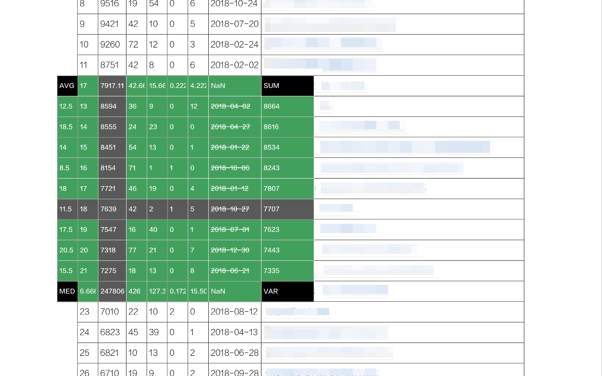
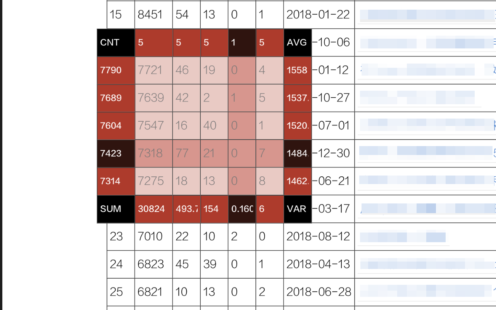
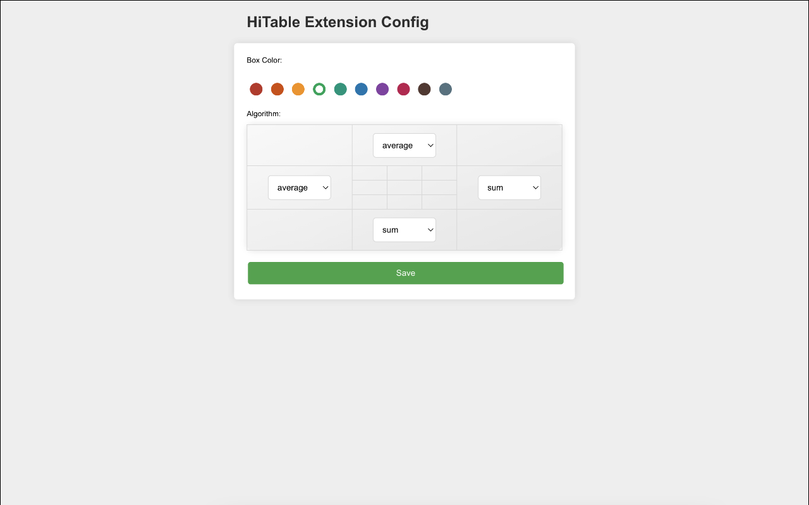
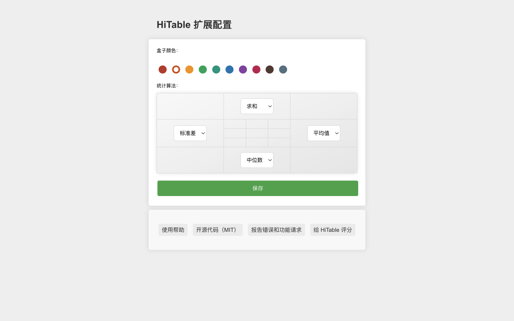

# HiTable — Instant Analysis of Web Page Table Data


%20%7C%20DE%20%7C%20RU%20%7C%20JA%20%7C%20KO%20%7C%20HI%20%7C%20RO-blue?style=for-the-badge&color=8bc34a)


---

## English

> Analyze data instantly on web page tables, without leaving the page, without copying data, without Excel.

### Features

#### Table Support

- **Standard HTML tables** — including complex ones with merged cells (rowspan/colspan)
- **Nested tables** — tables inside tables, recursively flattened into one unified grid
- **Div-based tables** — CSS Grid / Flexbox layouts detected by class patterns and geometric analysis
- **ARIA grids** — elements with `role="grid"` or `role="table"` detected via semantic markers

#### 15 Statistics Algorithms

| Category | Algorithms |
|---|---|
| Basic | CNT (Count), SUM (Sum), AVG (Average), MIN (Minimum), MAX (Maximum), RNG (Range) |
| Advanced | MED (Median), STD (Standard Deviation), VAR (Variance), MOD (Mode) |
| Quantile | Q1 (25%), Q3 (75%), IQR (Interquartile Range) |
| Distribution | SKW (Skewness), KUR (Kurtosis) |

#### Conditional Formatting & Anomaly Detection

- Three-scope anomaly detection: across the entire selection, within each column, and within each row
- Values deviating from the mean by more than 2× standard deviation are highlighted with a slow pulsing animation
- Hover over anomalous cells to see the reason (global / column / row) and specific deviation values
- Toggle on/off in the configuration page

#### Data Integrity Checks

Six statistical tests to help identify potentially fabricated data:

| Test | What it checks |
|---|---|
| **Benford's Law** | First-digit distribution vs natural patterns |
| **Last Digit** | Uneven last-digit distribution (human bias) |
| **Rounding Preference** | Excessive 0/5 endings (common in manually filled data) |
| **Duplicate Detection** | Unusually frequent values (possible copy-paste) |
| **Ratio Anomaly** | Near-constant cross-column ratios (may be formula-generated) |
| **Monotonic Sequence** | Over-linear sorted patterns (possible auto-fill) |

Results appear as a ⚠ indicator below the overlay. Problematic cells are visually marked with colored outlines.

#### Number Format Recognition

- Currency symbols: `$`, `€`, `£`, `¥`, `₹`, `₽`, `HK$`, `NT$`
- Magnitude suffixes: `K` (×1,000), `W`/`万` (×10,000), `M` (×1,000,000), `亿` (×100,000,000), `万亿` (×10¹²), `B` (×1,000,000,000)
- Romanian / European numbers: `1.234,56`, `1 234,56`; currency codes `RON`, `MDL` and `leu`/`lei` before or after the value
- Number format override in Config for ambiguous values such as `1,234`
- Full-width digits: `１２３` → 123
- Percentages: `12.5%` → 0.125
- Statistical results retain the source decimal format, currency position and magnitude suffix when consistent across a column or row; no currency conversion is performed
- Column types (integer, decimal, currency, percentage) shown in tooltips

#### Demo & Help

- **Demo Page**: 8 sample tables built into the extension. Right-click → **Demo**.
- **Help Page**: Comprehensive in-extension help covering all features, 10 languages. Right-click → **Help**.

### How to Use

1. **Activate**: Click the HiTable icon in your browser toolbar. The icon turns green when active.
2. **Select**: With HiTable active, drag across table cells. HiTable captures the table at the start; display, statistics and copying use that snapshot.
3. **View**: Statistics appear on all four sides of the selection.
4. **Choose algorithms**: Open an outer-corner menu to choose a statistic by its localized name.
5. **Copy data**: Press `Ctrl+C` (Mac: `⌘C`) to copy the selected cells. Press it **twice quickly** to copy the entire overlay including statistics.
6. **Quick select**: Hold `Shift` and click the top-left cell of a table to select the entire table.
7. **Clear / refresh**: Click outside the selection or press `Esc` to dismiss it. Drag again to capture fresh data.
8. **Deactivate**: Click the HiTable toolbar icon again to restore the page’s original table selection, links and controls. `Esc` only clears the selection; HiTable remains active.

Drag an inner data-corner handle to resize the range using the same snapshot; use arrow keys when a handle is focused. Press `Esc` during a resize to restore the previous range. Copying shows a success or failure notification with the selection dimensions. Algorithm menus open directly below their button at the same width, or above it when space is limited.

Non-numeric cells are greyed out and skipped in calculations; copying preserves their original text. Moving the mouse within the selected area highlights a cross-hair to help match rows and columns to their statistics.

Two activation modes: **Manual** (click to activate per tab) and **Auto** (automatically activates on specific domains).

[](https://github.com/wxy/HiTable)
[](https://github.com/wxy/HiTable)

### Configuration

Right-click the extension icon → **Config**. Customize:

- **Activation Mode**: Manual or Auto
- **Number Format**: Automatic (table/browser language), decimal comma, or decimal point
- **Theme**: Choose the multicolour swatch to select a colour family automatically from the page background, or one of 11 solid swatches to keep your chosen family. Both modes use designed light/dark palettes for data, statistics and highlighting, with matching text colours. White, grey and beige pages use Neutral Graphite in Automatic mode. Page theme changes update only the overlay colours; selection data, statistics and copying keep the same snapshot. The actual page background takes priority over the browser toolbar's appearance. Existing saved colours keep their family.
- **Enabled Algorithms**: Select which statistics appear in algorithm menus
- **Default Algorithms**: Set the default for each edge (top, right, bottom, left)
- **Conditional Formatting**: Toggle anomaly highlighting on/off

Automatic uses light Neutral Graphite to preview this settings page; actual overlays follow the webpage background in either mode. The demo offers 11 background colour families and a dark-background switch; select a background and drag cells again to compare.

[](https://github.com/wxy/HiTable)

### Installation

[](https://chromewebstore.google.com/detail/gepfjnfkjimhdfemijfnnpefdpocldpc)

Install from the [Chrome Web Store](https://chromewebstore.google.com/detail/gepfjnfkjimhdfemijfnnpefdpocldpc) or load as an unpacked extension from this repository.

### Development

```bash
git clone https://github.com/wxy/HiTable.git
# Load the repository as an unpacked extension in chrome://extensions
# Run tests: open chrome-extension://<ext-id>/pages/test.html
```

### Privacy

HiTable does **not** collect any user data. All data processing happens locally on your computer. No network requests to external services.

### License

[MIT](LICENSE)

### Feedback

[Open an issue](https://github.com/wxy/HiTable/issues) on GitHub.

---

## 中文

> 无需离开网页、无需复制数据、不用打开 Excel，即可在网页的表格上进行各种统计分析。

### 功能

#### 表格支持

- **标准 HTML 表格** — 包括含合并单元格（rowspan/colspan）的复杂表格
- **嵌套表格** — 表格中的表格，递归展开为统一网格
- **Div 表格** — CSS Grid / Flexbox 布局，通过类名模式和几何分析检测
- **ARIA 表格** — 带有 `role="grid"` 或 `role="table"` 的元素，通过语义标记检测

#### 15 种统计算法

| 分类 | 算法 |
|---|---|
| 基础 | CNT（计数）、SUM（求和）、AVG（平均值）、MIN（最小值）、MAX（最大值）、RNG（极差） |
| 高级 | MED（中位数）、STD（标准差）、VAR（方差）、MOD（众数） |
| 分位数 | Q1（25%）、Q3（75%）、IQR（四分位距） |
| 分布 | SKW（偏度）、KUR（峰度） |

#### 条件格式化与异常检测

- 三重范围异常检测：整个选区 / 列内 / 行内
- 偏离均值 2 倍标准差以上的值以慢脉冲动画高亮
- 悬停异常单元格可查看标记原因（全局/列/行）和具体偏离值
- 可在配置页面开关

#### 数据完整性检测

六项统计检测帮助发现潜在造假数据：

| 检测 | 检测内容 |
|---|---|
| **本福特定律** | 首位数字分布是否偏离自然规律 |
| **末位数字** | 末位数字分布是否不均匀（人为编造的随机感缺陷） |
| **取整偏好** | 过多以 0 或 5 结尾（常见于手工填写数据） |
| **重复检测** | 单一数值出现频率异常（疑似复制粘贴） |
| **比例异常** | 两列间比例几乎恒定（可能为公式生成） |
| **单调序列** | 排序后过于线性（可能为自动填充） |

结果以 ⚠ 指示器显示在浮层下方，问题单元格有彩色边框标记。

#### 数字格式识别

- 货币符号：`$`、`€`、`£`、`¥`、`₹`、`₽`、`HK$`、`NT$`
- 数量级后缀：`K`（千）、`W`/`万`（万）、`M`（百万）、`亿`、`万亿`、`B`（十亿）
- 罗马尼亚及欧洲数字格式：`1.234,56`、`1 234,56`；支持数字前后的 `RON`、`MDL` 和 `leu`/`lei`
- 配置中可指定数字格式，处理 `1,234` 等歧义数值
- 全角数字归一化：`１２３` → 123
- 百分比自动转换：`12.5%` → 0.125
- 统计结果保留列/行一致的小数格式、货币位置和数量级后缀；不进行汇率换算
- 列类型（整数/小数/货币/百分比）显示在 tooltip 中

#### 演示与帮助

- **演示页面**：内置 8 张示例表格，右键 → **演示**
- **帮助页面**：内建完整帮助，覆盖所有功能，支持 10 种语言。右键 → **帮助**

### 使用方法

1. **激活**：点击浏览器工具栏中的 HiTable 图标，图标变绿表示已激活
2. **选择**：激活后拖拽表格单元格；HiTable 在开始时固定表格数据，显示、统计和复制均使用这份快照
3. **查看**：四边显示统计结果
4. **选择算法**：点击外围角点的菜单，用本地化名称直接选择统计方法
5. **复制数据**：按 `Ctrl+C`（Mac: `⌘C`）复制选中单元格；**快速双击**复制整个浮层（含统计数据）
6. **快速全选**：按住 `Shift` 点击表格左上角单元格即可选择整个表格
7. **清除／刷新**：点击选择区外或按 `Esc` 关闭浮层，再次拖选可读取最新数据
8. **停用**：再次点击工具栏中的 HiTable 图标，恢复网页原有的表格选择、链接和控件操作。`Esc` 只清除选区，扩展仍保持激活

拖动内层数据选区的四角手柄可调整范围，手柄获得焦点后也可用方向键；调整沿用同一份快照，过程中按 `Esc` 恢复原范围。复制后会提示成功或失败以及选区行列数。

非数值单元格灰显并在计算时跳过，复制时保留原文。在选择区域内移动鼠标会高亮十字线，帮助对应行列与统计结果。

两种激活模式：**手动**（点击激活每个标签页）和**自动**（在特定域名自动激活）。

[](https://github.com/wxy/HiTable)
[](https://github.com/wxy/HiTable)

### 配置

右键扩展图标 → **配置**。可自定义：

- **激活模式**：手动或自动
- **数字格式**：自动（表格／浏览器语言）、逗号小数或句点小数
- **主题**：选择多彩色块按网页背景自动选择色系，或选择 11 种纯色色块之一固定色系。两种模式都根据网页实际明暗使用设计好的浅色或深色配色，数据区、统计区和高亮分别匹配文字颜色。自动模式在白色、灰色和米黄色页面选择中性石墨。页面切换主题时仅更新浮层样式，选区、统计和复制继续使用同一份数据快照；网页底色优先于浏览器工具栏外观。已有配色偏好保留所选色系。
- **启用算法**：选择算法菜单中出现的统计
- **默认算法**：设置四边各自的默认统计
- **条件格式化**：开关异常值高亮

选项页在自动模式下使用浅色中性石墨预览，实际浮层跟随网页底色；演示页提供 11 个背景色系和深色背景开关，切换后重新拖选即可对比。算法菜单与按钮同宽，在按钮下方展开，空间不足时向上展开。

[](https://github.com/wxy/HiTable)

### 安装

[](https://chromewebstore.google.com/detail/gepfjnfkjimhdfemijfnnpefdpocldpc)

从 [Chrome 应用商店](https://chromewebstore.google.com/detail/gepfjnfkjimhdfemijfnnpefdpocldpc) 安装，或从此仓库作为未打包扩展加载。

### 开发

```bash
git clone https://github.com/wxy/HiTable.git
# 在 chrome://extensions 中加载仓库目录为未打包扩展
# 运行测试：打开 chrome-extension://<扩展ID>/pages/test.html
```

### 隐私

HiTable **不**收集任何用户数据。所有数据处理均在您的计算机上本地完成，不向任何外部服务发送网络请求。

### 许可证

[MIT](LICENSE)

### 反馈

在 [GitHub](https://github.com/wxy/HiTable/issues) 上提交 issue。
