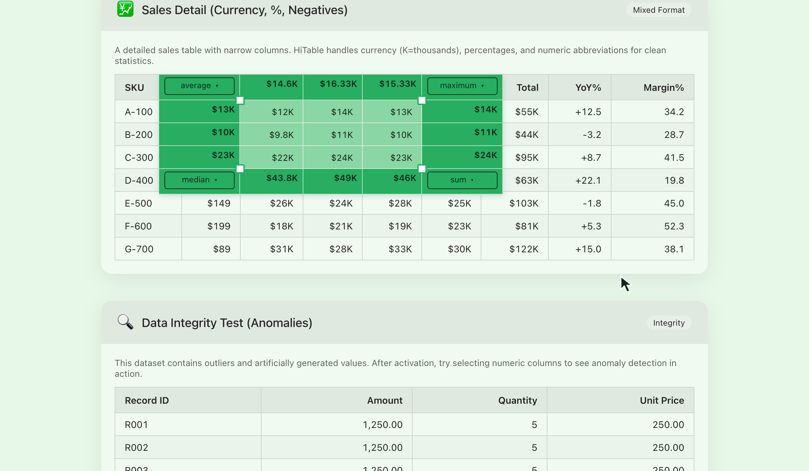
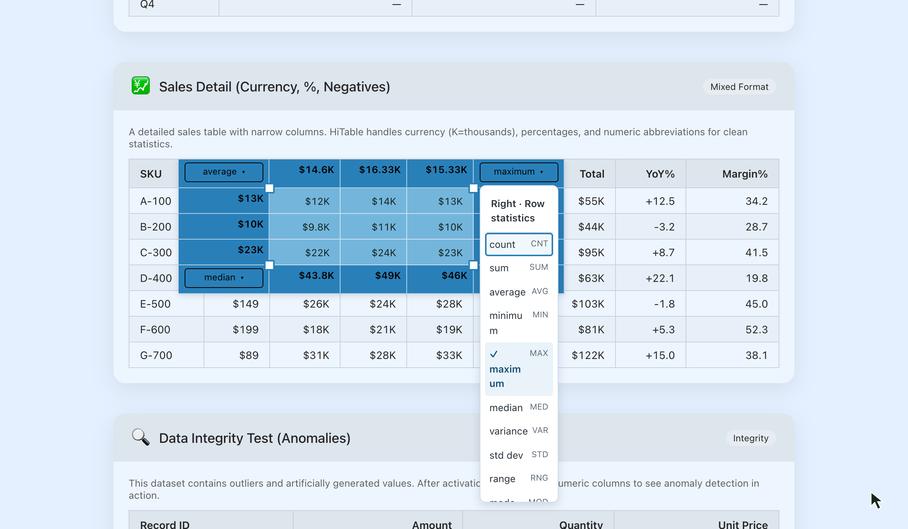
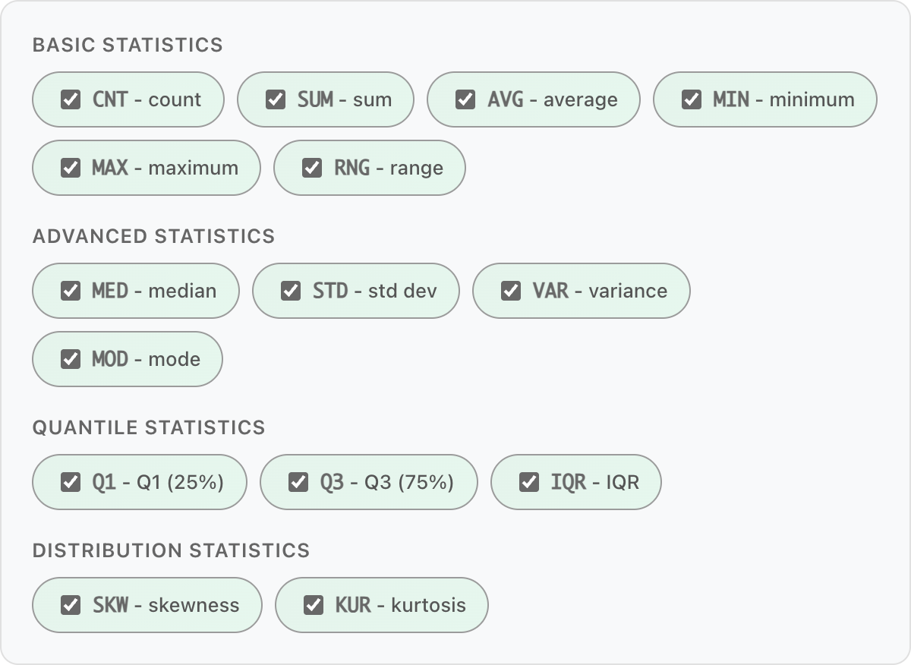

# Run statistics on web tables without leaving the page

I kept running into a small problem while browsing the web. I would come across a table and want to add a few numbers or check an average. Copying the data was awkward, and working through it by hand was tedious.

There are extensions that copy web tables into Excel. That is useful when you want to keep working with the data. But often I only wanted an answer about the numbers already in front of me. Opening a spreadsheet and arranging the data felt like several extra steps for a small calculation.

What I wanted was simple: stay on the page, select a few cells, and see the result.

So I built **HiTable**, a Chrome extension for quick statistics on web tables.

## Calculate where you are reading

Click the HiTable toolbar icon to activate it, then drag across the cells you want to examine. Statistics appear around all four sides of the selection, aligned with the corresponding rows and columns.

You might be checking the total for a few items in a report, comparing average prices in a list, or looking for the highest and lowest values in a public data table. Select the relevant cells, read the result, and carry on with the page.

That is the small task I want HiTable to do well: make a quick calculation part of reading, without making you move the data first.

## Adjust the range and choose the calculation

The first selection is not always quite right. Grab one of its four corner handles to expand or shrink the range.

Each outer corner can use a different statistic: for example, Average at the top, Maximum on the right, Sum at the bottom and Median on the left. Open a corner menu to change the calculation for that edge.

HiTable supports **15 statistics**: Count, Sum, Average, Minimum, Maximum, Range, Median, Standard Deviation, Variance, Mode, Lower Quartile, Upper Quartile, Interquartile Range, Skewness and Kurtosis. Choose which ones appear in the menus in Config, then scroll the menu to see more options.

Nonnumeric cells are greyed out so you can distinguish labels from values. You can let the overlay choose a theme for the page background or keep a colour family you prefer.

When you need to use the data elsewhere, press **Ctrl+C** (**⌘C** on Mac) to copy the selected cells. Press the shortcut twice quickly to include the surrounding statistics. A confirmation shows how many rows and columns were copied.

## Turn it on when you need it

Some tables already have their own selection gestures and controls. While HiTable is active, it takes over table selection. Click the toolbar icon again to deactivate it and restore the page's original interactions. Esc clears the current selection while leaving HiTable active.

Display, statistics and copying use the same snapshot taken when selection begins. If the page updates its numbers, clear the selection and drag again to capture fresh data.

Table processing happens locally. There is no account to create, and your selected table data is not uploaded to a server. The source is available on GitHub.

## Try it on a table

HiTable now has more than 500 users. I would like to learn which small, recurring calculations it helps with in other people's work.

After installing it, right-click its toolbar icon and open Demo. The built-in examples include ordinary tables, merged cells and currency values, so you can try selecting and calculating without finding a suitable website first.

HiTable supports several web-table structures, though individual sites can have unusual implementations. If a table does not work as expected, please report it.

**Which website and table would you like to use it on?** Tell me what you were trying to calculate, too. A specific task is useful guidance for making the extension better.

- [Install HiTable from the Chrome Web Store](https://chromewebstore.google.com/detail/hitable/gepfjnfkjimhdfemijfnnpefdpocldpc)
- [Product page](https://xingyu.wang/extensions/hitable)
- [Source and feedback](https://github.com/wxy/HiTable)
