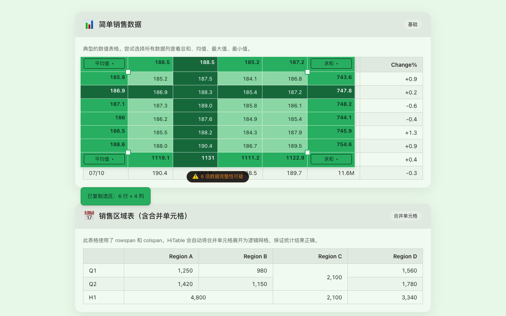
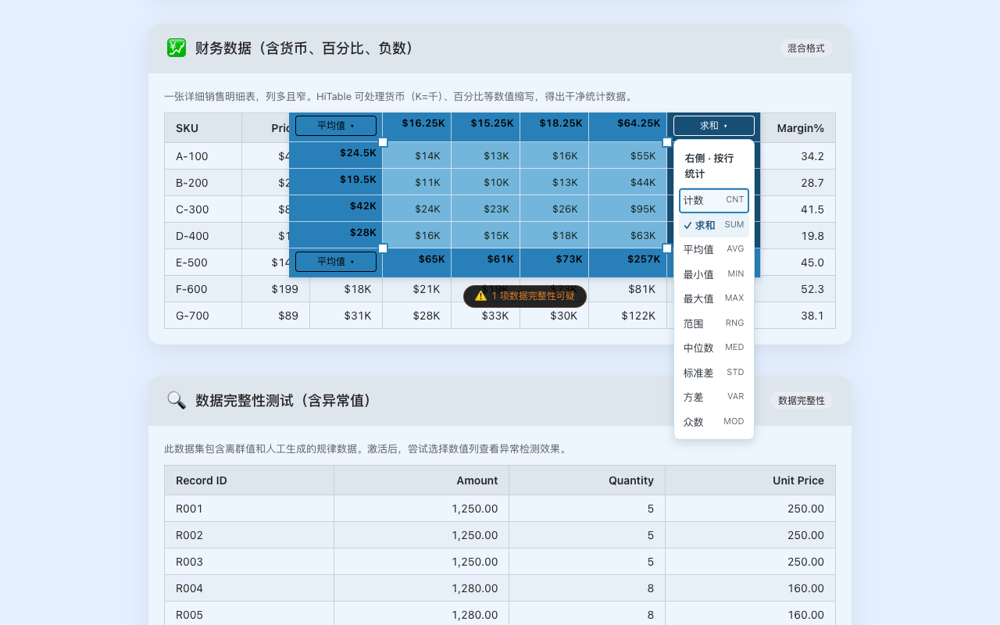

# 不离开网页，直接对网页表格进行统计计算

我之前在浏览网页时，经常会遇到一些表格。有时看着其中几行数据，想算一下合计或者平均值，却发现这件小事并不方便：复制数据不顺手，手工计算又很麻烦。

我也见过一些扩展，可以把网页表格直接复制到 Excel，方便进一步分析。对于需要继续整理、计算的数据，这当然很有用。但我当时的需求往往很简单，只是想知道眼前几个数字加起来是多少。为此再打开表格软件、整理一遍数据，总觉得步骤有些多。

我想要的其实是：留在当前网页，选中几个单元格，直接看到统计结果。

于是，我做了一个 Chrome 扩展，叫 **HiTable**。

## 在网页上，顺手算一下

使用方式很简单：点击浏览器工具栏里的 HiTable 图标，激活扩展，再在表格上拖选一片数据。

选区的四周会出现统计结果。每一行、每一列的结果就在对应的位置，可以顺着表格直接看过去。想知道合计、平均值，或者最大值和最小值，不用先把数据搬到别处。

比如，查看一份网页报表时，你可能只关心其中几个项目的金额合计；浏览价格列表时，想知道这一组价格的平均值；阅读公开数据时，想看看几年的数值范围。这样的临时计算，拖选以后就能得到结果，随后继续读原来的页面。

这也是我最希望 HiTable 做好的事情：让一次小计算自然地发生在阅读过程中。

## 想算哪一块，就选哪一块

第一次拖选不一定刚好选中想要的范围。HiTable 可以抓住选区四个角上的小手柄，向外扩大或者向内缩小，不必每次重新选择。

选区外围的角落里有算法菜单。打开后，可以直接按名称选择“求和”“平均值”“最大值”等统计方式。当前支持 15 种统计，不过日常使用时，先用自己熟悉的几种就够了。

表格里的标题、名称等非数值内容会灰显，帮助你区分哪些格子参与了数值统计。浮层也有不同的配色，可以跟随页面背景自动选择，或者固定使用自己喜欢的主题。

如果要把这次计算的结果继续用在别处，可以按 **Ctrl+C**（Mac 上是 **⌘C**）复制选中数据；快速连续按两次，可以连同四边统计一起复制。复制后会显示提示，告诉你复制了多少行、多少列。

## 用的时候接管，用完交还

有些网页的表格本身也带有拖拽、点击等交互。激活 HiTable 后，表格的选择操作由扩展接管；再次点击工具栏图标取消激活，就能恢复网页原有的操作。

按 Esc 可以清除当前选区。这里要区分一下：清除选区以后，HiTable 仍然处于激活状态。

另外，显示、统计和复制使用的是开始拖选时的同一份数据快照。如果页面里的数字已经更新，清除选区后重新拖选，就能读取新的数据。

HiTable 的表格处理在本地完成，无需注册账号，也不会把你选择的表格数据上传到服务器。项目源码公开在 GitHub，感兴趣的话可以查看。

## 从一张表格试起

按照目前的用户数，HiTable 已经有 500 多位用户。我很想知道，它在大家各自的工作中，是否也解决了这样一个不起眼、却反复出现的小麻烦。

安装以后，可以右键点击扩展图标，打开内置演示页。里面有普通表格、合并单元格、货币数值等示例，不需要先找一张合适的网页，就能试试拖选和统计。

HiTable 支持多种网页表格结构，但具体网站仍可能有自己的特殊实现。如果遇到识别不了或操作不顺手的表格，欢迎反馈。

**你最想在哪个网站的哪张表格上使用它？** 如果方便，也请告诉我你当时想完成什么计算。这比一个笼统的功能建议更能帮助我把它做好。

- [在 Chrome 应用商店安装 HiTable](https://chromewebstore.google.com/detail/hitable/gepfjnfkjimhdfemijfnnpefdpocldpc)
- [产品介绍](https://xingyu.wang/zh/extensions/hitable)
- [源码与问题反馈](https://github.com/wxy/HiTable)
